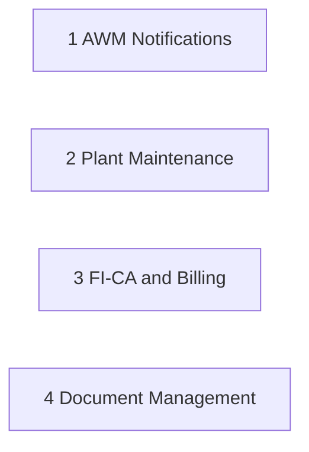

# Integration map

How the four areas of this portfolio connect. The map grows as the areas are covered: an integration point is added only after the lesson that explains it.

## Integration points

| From | To | What connects them | Added in |
|------|----|--------------------|----------|
| – | – | – | – |

## Planned

Topics already known to cross area boundaries, to be detailed in the lesson shown.

| Topic | Areas | Lesson |
|-------|-------|--------|
| Reference objects of a notification | AWM, PM, IS-U master data | 1.7 |
| From notification to order | AWM, PM | 1.8 |
