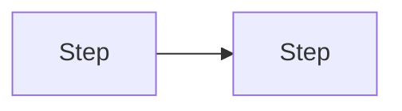

# Functional solution: <title>

| | |
|---|---|
| Company | Meltemi Grid S.A. (fictional) |
| Area | <area> |
| Author | <name> |
| Status | Draft / Reviewed |
| Execution status | Tested on <system, release> / Designed, not executed |

## 1. Business context and problem

Who has the problem, what it costs them today, and what they asked for. No SAP terms in this section.

## 2. Scope and assumptions

| In scope | Out of scope |
|----------|--------------|
| | |

Assumptions:

- ...

## 3. Process

### 3.1 As-is

### 3.2 To-be

| Step | Role | System action | Result |
|------|------|---------------|--------|
| | | | |

## 4. Master data and organisational structure

| Object | Value | Why it is needed |
|--------|-------|------------------|
| | | |

## 5. Standard coverage and fit-gap

For each requirement, climb the ladder and stop at the first step that works:
standard customizing, then process or master data change, then key-user extensibility, then development.

| # | Requirement | Covered by | Ladder step | Gap |
|---|-------------|------------|-------------|-----|
| | | | | |

## 6. Customizing

| IMG path | Setting | Value | Reason |
|----------|---------|-------|--------|
| | | | |

## 7. Business rules and exceptions

| # | Rule | Exception |
|---|------|-----------|
| | | |

## 8. Developments

| # | Development | Closes gap | Technique |
|---|-------------|------------|-----------|
| | | | |

## 9. Test scenarios

### Scenario 1: <name>

- **Given** ...
- **When** ...
- **Then** ...
