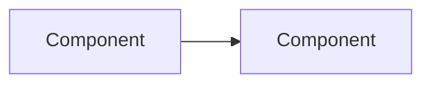

# Technical solution: <title>

| | |
|---|---|
| Functional solution | [functional-solution.md](functional-solution.md) |
| Target release | SAP S/4HANA 2023 on-premise, IS-U |
| Author | <name> |
| Status | Draft / Reviewed |
| Execution status | Tested on <system, release> / Designed, not executed |

## 1. Architecture

## 2. Data model

### 2.1 Standard objects

| Object | Type | Key | Used for |
|--------|------|-----|----------|
| | | | |

### 2.2 Custom objects

| Object | Type | Key | Purpose |
|--------|------|-----|---------|
| | | | |

## 3. Design decisions

| # | Decision | Alternatives rejected | Reason |
|---|----------|-----------------------|--------|
| | | | |

Where no released API exists and a classic technique is used (BAPI, BAdI, user exit, event), state the trade-off here.

## 4. Object list

| Object | Type | Package | Description |
|--------|------|---------|-------------|
| | | | |

## 5. Core logic

Describe the logic in steps and point to the source, for example `src/zcl_mg_....clas.abap`.

## 6. Error handling

| Situation | Behaviour | Message to the user |
|-----------|-----------|---------------------|
| | | |

## 7. Authorizations

| Authorization object | Field values | Who needs it |
|----------------------|--------------|--------------|
| | | |

## 8. Performance

Expected volumes, access paths, and what was done to keep them efficient.

## 9. Tests

| Test | Type | Covers |
|------|------|--------|
| | ABAP Unit / manual | |

## 10. Limitations

- ...
